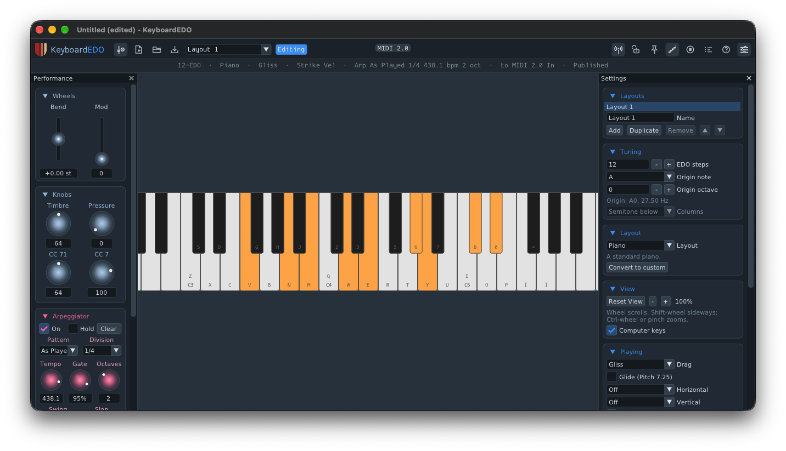

# KeyboardEDO

An on-screen MIDI 2.0 keyboard from Unlikelyware for any equal division of the octave: 12-EDO, 17,
19, 22, 31, 53 or any other from 5 to 72 steps. Play it with a mouse, a trackpad, a touchscreen
or your computer's keyboard, and it sends MIDI to a synth, a host or another app.



| | |
|---|---|
| Kind | App: a MIDI controller (CoreMIDI on macOS, the ALSA sequencer on Linux) |
| Platforms | Linux x86-64, macOS 26 or later on Apple Silicon. No Windows |
| Version | 0.9.0 (preview) |
| License | MIT |

**Downloads:** ready-built apps will be on itch.io with the 0.9 preview. This repo has the
source only.

## What makes it different

- **Exact pitch, not pitch-bend tricks.** Each note carries its pitch as MIDI 2.0 Pitch 7.9, so a
  31-EDO step sounds as a 31-EDO step on any receiver that honours it, with per-note pitch bend,
  per-note controllers and per-note pressure, and Pitch 7.25 glides. MIDI 1.0 receivers get MIDI 1.0
  automatically.
- **Keyboards made for EDOs.** A standard piano at 12-EDO, a diamond piano at other EDOs, tiled
  layouts of diamond keys at any EDO (most of them isomorphic), and custom layouts built key by key.
- **Several layouts in one document.** A `.kedo` document holds layouts, each with its own tuning,
  switched between while you play. An arpeggiator and a scale highlight are built in. Documents from
  KeyEDO, its macOS and iPadOS predecessor, import as one layout.

The Unlikelyware synths play its notes at their exact pitch, and through
[StageHand](https://github.com/erickampman/StageHand) any CLAP instrument that takes MIDI 2.0. The
help page (Help in the app, or [resources/help/help.md](resources/help/help.md)) covers it all.
[docs/decisions.md](docs/decisions.md) says why it's built this way, and
[docs/roadmap.md](docs/roadmap.md) what comes next.

## Known gaps

- **One finger at a time on a Mac touchscreen.** macOS passes a touch on the screen to the app as
  a mouse click, so a touchscreen plays like a mouse: one key at a time. Several fingers at once
  need a change to SDL, planned before 1.0. On Linux, SDL passes every finger on, so several keys
  should play at once; that hasn't been checked by hand on a touchscreen yet.

## Installing

**macOS:** drag `KeyboardEDO.app` into Applications. The first time you open it, macOS asks whether to
open an app downloaded from the internet: click Open.

**Linux:** unpack the download anywhere you'll keep it, such as `~/.local/lib/keyboardedo`, and keep
`keyboardedo` and its `help` folder together (Help looks for `help/` beside the executable). To run
it as plain `keyboardedo`, link it into a directory on your `PATH`:

```bash
ln -sf ~/.local/lib/keyboardedo/keyboardedo ~/.local/bin/keyboardedo
```

What each platform needs is in the downloads repo's
[install notes](https://github.com/erickampman/unlikelyware#installing).

### Playing a DAW on Linux

Some Linux DAWs don't see KeyboardEDO's own MIDI port, so send it to a port they do see, with
**Send to** in the routing menu:

- **REAPER** (its audio system set to JACK, run through PipeWire): REAPER lists only hardware
  ports. Send to **Midi Through Port-0** and enable `Midi Through` in REAPER's MIDI inputs.
- **Bitwig**: Bitwig sees only raw MIDI devices. Load the virtual MIDI module, send to
  **VirMIDI 1-0**, and pick `VirtualRawMIDI/1` as the track's input:

  ```bash
  sudo modprobe snd-virmidi
  ```

  To load it at every boot:

  ```bash
  echo snd-virmidi | sudo tee /etc/modules-load.d/virmidi.conf
  ```

Both take MIDI 1.0, so KeyboardEDO sends each note as the nearest 12-EDO note. For microtones there,
play a 12-EDO layout into a note effect that makes them, such as
[EDOSpread12](https://github.com/erickampman/EDOSpread12), in front of the synth.
[StageHand](https://github.com/erickampman/StageHand) takes MIDI 2.0 and plays every layout exactly.

## Building from source

```bash
git clone https://github.com/erickampman/KeyboardEDO.git
cd KeyboardEDO
tools/fetch_deps.sh
cmake -B build -G Ninja -DCMAKE_BUILD_TYPE=Release
cmake --build build
```

[BUILDING.md](BUILDING.md) has what to install first on Linux and macOS, the tests, and how to run
it and its tools.

## Help and bugs

Questions and bug reports go to [GitHub Issues](https://github.com/erickampman/KeyboardEDO/issues).

## License

MIT. See [LICENSE](LICENSE) and [THIRD_PARTY_NOTICES.md](THIRD_PARTY_NOTICES.md).

## Trademarks

VST® is a registered trademark of Steinberg Media Technologies GmbH. Audio Units, Logic, Mac and
macOS are trademarks of Apple Inc., registered in the U.S. and other countries. Linux is the
registered trademark of Linus Torvalds in the U.S. and other countries. Other product names are
trademarks of their owners, named here only to say what works with what.
